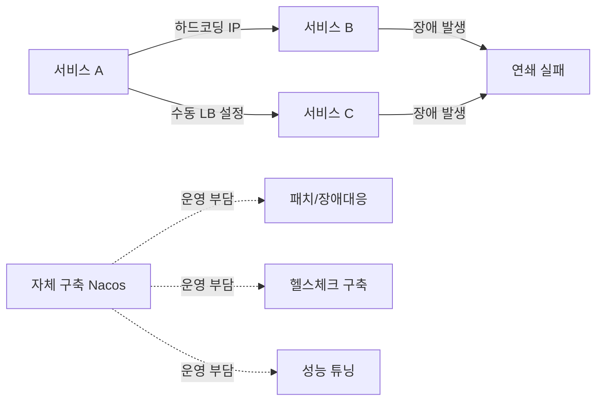
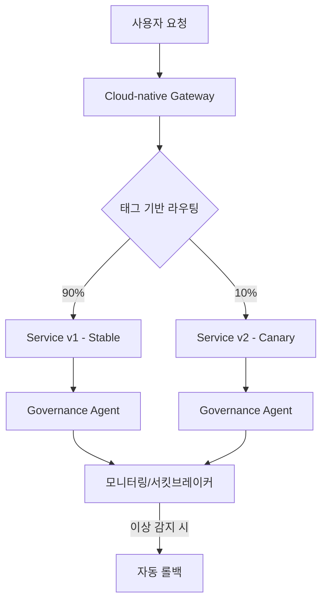

## TL;DR

> 알리바바 클라우드 MSE는 Nacos/ZooKeeper/Eureka 레지스트리와 Spring Cloud·Dubbo 거버넌스를 완전관리형으로 제공하는 서비스다.
> 레지스트리는 SLA 99.99%·최대 300% 빠른 푸시 성능으로 자체 구축을 대체하고, 거버넌스는 코드 변경 없이 카나리 릴리스·서킷브레이커를 주입한다.
> 실제 도입 사례에서 가용성 99.95%, 응답시간 50% 단축이 보고되었다.

---

## 무엇인가 (What)

MSE(Microservices Engine)는 알리바바 클라우드가 제공하는 **완전관리형 마이크로서비스 플랫폼**이다. 4개 모듈로 구성되며, 이 글에서는 그중 핵심인 **Registry(등록·구성 센터)**와 **Governance(마이크로서비스 거버넌스)**를 다룬다.

| 모듈                                | 역할                        | 호환 오픈소스                                   |
| ----------------------------------- | --------------------------- | ----------------------------------------------- |
| **Registry & Configuration Center** | 서비스 등록/발견, 설정 관리 | Nacos, ZooKeeper, Eureka                        |
| **Microservices Governance**        | 무침습 트래픽 거버넌스      | Spring Cloud, Apache Dubbo, Sentinel, OpenSergo |
| Cloud-native Gateway                | K8s Ingress 표준 게이트웨이 | Ingress, Envoy                                  |
| SchedulerX                          | 분산 작업 스케줄링          | XXL-JOB, ElasticJob, K8s Job                    |

### Registry vs Governance, 무엇이 다른가

두 모듈은 층위가 다르다. Registry는 "서비스가 어디 있는지"를 관리하는 **인프라 계층**이고, Governance는 "트래픽을 어떻게 흘려보낼지"를 관리하는 **애플리케이션 계층**이다.

| 구분           | Registry                             | Governance                     |
| -------------- | ------------------------------------ | ------------------------------ |
| 해결 대상      | 서비스 위치 관리 (등록/발견)         | 트래픽 안정성 (장애 확산 방지) |
| 적용 방식      | 클러스터 교체 (Nacos/ZooKeeper 호환) | 에이전트 연결 (코드 무수정)    |
| 과금 기준      | 스펙(CPU/메모리) × 노드 수           | 에이전트 수 × 실행 시간        |
| 자체 구축 대안 | 오픈소스 Nacos/ZooKeeper 직접 운영   | Istio 같은 서비스 메시 도입    |

---

## 왜 필요한가 (Why)

### 자체 구축 레지스트리의 한계

마이크로서비스 개수가 늘어나면 하드코딩된 IP와 수동 로드밸런서 구성이 병목이자 단일 장애점(SPOF)이 된다. 여기에 자체 구축 Nacos/ZooKeeper 클러스터를 운영하면 다음 부담이 추가된다.

- 클러스터 구성·패치·장애 대응을 직접 담당
- 대규모 트래픽에서의 성능 튜닝을 직접 검증
- 헬스체크·모니터링·알림 체계를 별도로 구축

아래는 자체 구축 환경에서 흔히 발생하는 문제 상황이다.



### MSE가 제공하는 대안

- **레지스트리**: SLA 99.99% 보장, 오픈소스 Nacos 대비 최대 300% 빠른 서비스 푸시 성능. MSE Sync 도구로 기존 자체관리형 레지스트리를 무중단에 가깝게 이관 가능
- **거버넌스**: 코드·이미지 변경 없이 에이전트만 연결하면 카나리 릴리스, 서킷브레이커, 트래픽 보호를 즉시 사용 가능

실제 도입 사례로 Laidian Technology는 MSE Governance로 전체링크 카나리 릴리스와 이상 인스턴스 자동 제거 체계를 구축해 **서비스 가용성 99.95%**를 달성했고, 한 클라우드 네이티브 게이트웨이 도입 고객은 기존 Nginx Ingress 규칙을 재구성하지 않고도 **응답 시간을 50% 단축**했다.

> 한 줄 요약: 레지스트리는 "안 죽는 인프라"를, 거버넌스는 "안전하게 배포하는 방법"을 사서 쓰는 것이다.

---

## 어떻게 동작하는가 (How)

### Registry: 멀티존 고가용성

MSE Registry는 Nacos 2.0 아키텍처 기반으로, 엔터프라이즈 배포 시 최소 3노드를 권장한다. 노드 장애 시 수 초 내 재라우팅되며, 멀티존 배포에서는 존 간 지연 3ms 이하를 유지하다가 한 존이 죽으면 애플리케이션 코드 수정 없이 다른 존으로 자동 전환된다.

장애 대응 방식도 두 방향으로 나뉜다. Consumer 측은 "빈 목록(empty list) 보호"로 등록 목록 갱신이 비정상일 때 기존 목록을 유지하고, Provider 측은 비정상 인스턴스 비율이 임계치를 넘으면 완전 중단 대신 저하된 서비스로 응답을 이어간다.

### Governance: 무침습 트래픽 제어 흐름

아래는 카나리 릴리스 시나리오에서 요청이 흐르는 경로다. 별도 코드 배포 없이 거버넌스 콘솔에서 라우팅 규칙만 바꾸면 트래픽 비율이 즉시 반영된다.



### 예시: Spring Cloud 애플리케이션의 Nacos 등록 설정

기존 오픈소스 Nacos를 그대로 MSE Nacos 인스턴스 주소로 교체하면 되므로, 애플리케이션 코드는 수정할 필요가 없다.

```yaml
spring:
  cloud:
    nacos:
      discovery:
        server-addr: mse-xxxxxxxx-nacos-ans.mse.aliyuncs.com:8848
        namespace: ${NACOS_NAMESPACE}
        group: DEFAULT_GROUP
```

거버넌스 에이전트는 별도 배포 없이 JVM 옵션으로 붙인다.

```bash
java -javaagent:/opt/mse/mse-agent.jar \
  -Dmse.appName=order-service \
  -Dmse.namespace=prod \
  -jar order-service.jar
```

---

## 선택 가이드

레지스트리 엔진과 거버넌스 에디션은 트래픽 규모와 안정성 요구 수준에 따라 고른다.

| 옵션                          | 특징                          | 추천 상황                                       |
| ----------------------------- | ----------------------------- | ----------------------------------------------- |
| Registry Developer Edition    | 1~2코어, 저비용               | 개발/테스트 환경, PoC                           |
| Registry Professional Edition | 최대 16코어, Nacos 2.0 고성능 | 프로덕션, 대규모 서비스 수                      |
| Governance Professional       | $0.008/에이전트/시간          | 카나리·서킷브레이커 등 기본 거버넌스            |
| Governance Enterprise         | $0.025/에이전트/시간          | 전체링크 그레이스케일, 고급 트래픽 보호 필요 시 |

---

## 참고 자료

- [What is MSE?](https://www.alibabacloud.com/help/en/mse/product-overview/what-is-mse/)
- [What is Microservices Governance?](https://www.alibabacloud.com/help/en/mse/product-overview/what-is-microservice-governance)
- [Traffic governance 가이드](https://www.alibabacloud.com/help/en/mse/user-guide/traffic-governance/)
- [Implement HA capabilities of MSE Registry](https://www.alibabacloud.com/help/en/mse/use-cases/implement-high-availability-capabilities-of-mse-microservices-registry)
- [MSE billing overview (Registry)](https://www.alibabacloud.com/help/en/mse/product-overview/billing-overview-1/)
- [Billing of Microservices Governance](https://www.alibabacloud.com/help/en/mse/product-overview/billing-overview)
- [Common Scenarios of MSE](https://www.alibabacloud.com/help/en/mse/product-overview/common-scenarios)
- [Nacos Enterprise Edition capacity & billing guide](https://help.aliyun.com/en/mse/product-overview/nacos-platinum-edition-capacity-description)
- [Registry migration (MSE Sync)](https://www.alibabacloud.com/help/en/mse/use-cases/registry-migration/)
- [Spring Cloud Alibaba Nacos Discovery Wiki](https://github.com/alibaba/spring-cloud-alibaba/wiki/nacos-discovery-en)
