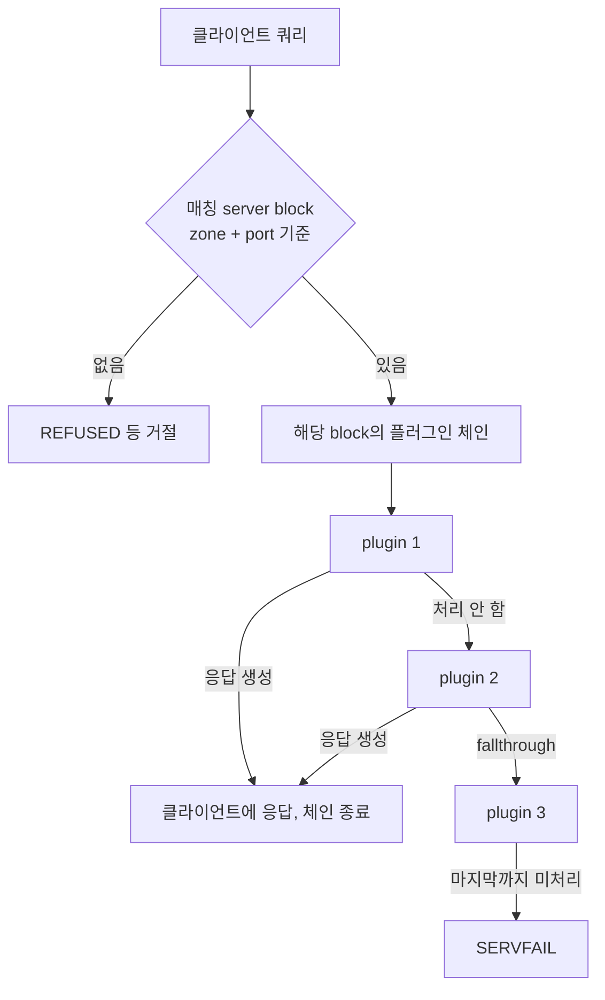
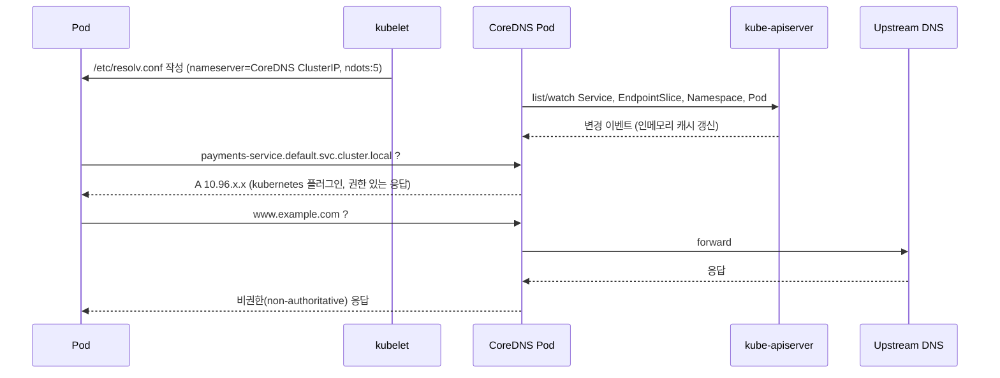

| 항목 | 내용 |
|------|------|
| 난이도 | 초급 ~ 중급 |
| 대상 | Kubernetes 운영팀, 플랫폼/인프라 엔지니어 |
| 범위 | CoreDNS 자체 동작 + Kubernetes 클러스터 DNS 구성 |
| 기준 버전 | 1.12.x 문서 (조사 시점 2026-10-06) |
| 사전 지식 | DNS 기본(A/SRV, NXDOMAIN), Kubernetes Service |

**TL;DR**: CoreDNS는 Corefile의 server block 단위로 플러그인 체인을 하나씩 가지며, 쿼리는 체인을 순서대로 통과하다가 응답을 만드는 첫 플러그인에서 끝납니다. 체인 순서는 Corefile 작성 순서가 아니라 빌드 시점의 `plugin.cfg`가 결정합니다. Kubernetes에서는 `kubernetes` 플러그인이 API 서버를 watch해 클러스터 내부 이름을 답하고, 그 외 이름은 `forward`로 upstream에 넘깁니다.

---

## 📋 1. Context: CoreDNS가 무엇인가

- Go로 작성된 DNS 서버/포워더, 모든 기능이 플러그인
- Caddy 서버 프레임워크 기반의 플러그인 체인 구조
- Kubernetes 1.11부터 기본 클러스터 DNS (kube-dns 대체)
- 설정 파일은 `Corefile` 하나, 시작 시 현재 작업 디렉터리에서 탐색

### 타임라인

| 시점 | 내용 |
|------|------|
| Kubernetes 1.11 | CoreDNS GA, kube-dns 대체 |
| 현재 | `coredns -plugins`로 확인 가능한 내장 플러그인 다수, 외부 플러그인 컴파일 추가 가능 |

---

## 📡 2. 통신 방식

### 2-1. 클라이언트 → CoreDNS (수신)

CoreDNS는 server block 헤더에 스킴을 붙여 수신 프로토콜을 정합니다.

| 프로토콜 | Corefile 스킴 | 비고 |
|----------|---------------|------|
| UDP/TCP (전통 DNS) | `dns://` 또는 생략 | 기본값, 포트 53 |
| DoT (RFC 7858) | `tls://` | `tls` 플러그인으로 인증서 지정 |
| DoQ (RFC 9250) | `quic://` | `tls` 플러그인 필요 |
| DoH (HTTP/2) | `https://` | TLS 종료를 CoreDNS가 하거나 앞단 프록시가 대행 |
| gRPC | `grpc://` | 표준 프로토콜 아님 |

```
tls://example.org grpc://example.org {
```

```
quic://example.org {
    tls mycert mykey
}
```

```
https://example.org {
    tls mycert mykey
}
```

> DoH를 평문 HTTP로 열 수도 있지만, 이 경우 앞단에 TLS 종료 프록시가 반드시 있어야 클라이언트가 접속할 수 있습니다.

DoT/DoQ/DoH/gRPC의 기본 포트값은 Corefile 명시 여부에 따라 달라지므로 운영 환경에서는 포트를 직접 지정하고 `확인 필요` 항목으로 점검합니다.

### 2-2. CoreDNS → Upstream (송신)

`forward` 플러그인이 upstream 리졸버로 쿼리를 전달합니다.

- 이미 열린 소켓 재사용
- upstream이 여러 개면 첫 사용 시 랜덤 선택
- server block당 `forward` 1개 사용 (Corefile 안에 여러 개 두면 나열 순서대로 평가)
- TLS 사용 시 최소 TLS 1.2

| 옵션 | 동작 |
|------|------|
| `force_tcp` | 요청이 UDP로 와도 TCP로 전송 |
| `prefer_udp` | 요청이 TCP로 와도 먼저 UDP 시도 |
| `policy random\|round_robin\|sequential` | upstream 선택 방식, 기본 random |
| `max_fails N` | 0이면 헬스 체크 없이 항상 정상 취급 |
| `health_check DURATION` | upstream 헬스 체크 주기 |

`force_tcp`와 `prefer_udp`를 같이 지정하면 `force_tcp`가 우선합니다.

```
forward . 8.8.8.8 1.1.1.1 {
    policy round_robin
    health_check 5s
}
```

---

## 🔄 3. 처리 프로세스

### 3-1. 전체 흐름



> 쿼리는 정확히 하나의 플러그인 체인만 통과합니다. server block마다 체인이 따로 있습니다.

### 3-2. 플러그인의 네 가지 반응

| 유형 | 동작 | 예시 |
|------|------|------|
| 처리 | 응답을 만들고 체인 종료 | `whoami` |
| 미처리 | 다음 플러그인 호출 | 해당 zone이 아닌 `hosts` |
| Fallthrough | 처리 후 NXDOMAIN 등이면 다음 플러그인으로 넘김 | `kubernetes`, `hosts`의 `fallthrough` |
| 처리 + 힌트 | 요청을 가공하거나 응답에 정보를 덧붙이고 항상 다음 호출 | `rewrite`, `bind` |

체인 끝까지 아무도 처리하지 않으면 CoreDNS가 SERVFAIL을 반환합니다.

### 3-3. 체인 순서

- 실행 순서는 Corefile 작성 순서와 무관
- 빌드 시점의 `plugin.cfg`가 순서를 결정
- 순서를 바꾸거나 플러그인을 추가·제거하려면 재컴파일 필요
- 요청 처리 로직이 없는 플러그인(`health`, `tls`, `root` 등)은 체인에 들어가지 않음

주요 플러그인의 상대 순서 (발췌, 전체는 `plugin.cfg` 확인 필요):

```
errors → log → loadbalance → cache → rewrite → autopath → hosts → kubernetes → file → forward
```

- `cache`가 데이터 소스보다 앞이라 캐시 히트 시 `kubernetes`는 실행되지 않음
- `hosts`가 `kubernetes`보다 앞이라 같은 이름이면 hosts 항목이 우선
- 표준 배포에서 `kubernetes`는 `file`, `etcd`보다 앞

### 3-3-1. 오류 응답과 체인

⚠️ 문제: 플러그인이 에러 응답을 반환해도 체인은 failover 하지 않습니다.
📝 원인: 에러 응답도 "처리된 것"으로 간주되어 뒤 플러그인은 쿼리를 보지 못합니다.
✅ 해결책: 백엔드 장애 대응은 체인이 아니라 `forward`의 다중 upstream/헬스 체크로 구성합니다.

### 3-4. 동시성

- 쿼리마다 goroutine 하나가 생성되고, 해당 goroutine 안에서 체인이 동기 실행
- `forward`는 `max_concurrent`로 동시 요청 상한 설정 가능
- `loop` 플러그인은 시작 시 forwarding loop 여부를 탐지

---

## ☸️ 4. Kubernetes에서의 동작

### 4-1. 구성 요소 관계



### 4-2. 단계별 정리

- kubelet이 Pod 시작 시 `/etc/resolv.conf` 작성, nameserver는 CoreDNS의 ClusterIP
- Pod → ClusterIP 접근은 kube-proxy 규칙(iptables DNAT 등)으로 CoreDNS Pod에 도달, 다른 노드의 Pod일 수 있음
- `kubernetes` 플러그인은 API 서버를 list/watch하고 인메모리 상태로 응답
- 클러스터 도메인 외 이름은 `forward`로 upstream 전달
- CoreDNS는 API 접근을 위해 Service, EndpointSlice 등에 대한 `list`, `watch` 권한이 필요

### 4-3. 대표 Corefile (kubeadm 기본값 예시, 배포판별 상이)

```
.:53 {
    errors
    health
    ready
    kubernetes cluster.local in-addr.arpa ip6.arpa {
        pods insecure
        fallthrough in-addr.arpa ip6.arpa
    }
    prometheus :9153
    forward . /etc/resolv.conf
    cache 30
    loop
    reload
    loadbalance
}
```

### 4-4. DNS 레코드 형식

| 대상 | 이름 형식 |
|------|-----------|
| Service | `<svc>.<ns>.svc.<cluster-domain>` |
| Headless Service의 Pod | `<pod>.<svc>.<ns>.svc.<cluster-domain>` (spec.subdomain 일치 시) |
| SRV (포트 인지) | `_<port>._<proto>.<svc>.<ns>.svc.<cluster-domain>` |

---

## ⚠️ 5. ndots와 search domain

Pod의 `/etc/resolv.conf`는 `options ndots:5`를 포함합니다. 점이 5개 미만인 이름은 search domain을 먼저 붙여서 질의합니다.

### 짧은 이름 (`payments-service`)

```
payments-service.default.svc.cluster.local   → 성공
```

search domain 덕분에 CoreDNS가 받기 전에 FQDN으로 확장됩니다.

### 외부 이름 (`www.example.com`, 점 2개)

```
www.example.com.default.svc.cluster.local    → NXDOMAIN
www.example.com.svc.cluster.local            → NXDOMAIN
www.example.com.cluster.local                → NXDOMAIN
www.example.com                              → 성공
```

외부 도메인 한 번을 조회하는 데 쿼리가 여러 번 발생합니다. 트래픽이 많은 클러스터에서는 CoreDNS 부하와 지연으로 이어집니다. A/AAAA 병행 조회 시 건수가 더 늘어납니다.

⚠️ 문제: 외부 도메인 호출이 많은 워크로드에서 DNS 쿼리 수 급증
📝 원인: `ndots:5` 기본값 때문에 search domain 확장이 선행됨
✅ 해결책: 두 가지 선택지가 있습니다.

```yaml
# 1. Pod 단위 (애플리케이션 팀 담당)
spec:
  dnsConfig:
    options:
      - name: ndots
        value: "2"
```

Pod 단위 조정은 영향 범위가 작아 안전하지만 모든 Pod 스펙을 수정해야 합니다. 서버 측에서 해결하려면 CoreDNS의 `autopath` 플러그인을 쓸 수 있으나, 이 경우 `kubernetes` 플러그인의 `pods verified` 설정이 필요한 등 부가 조건이 따릅니다 (확인 필요).

`ndots`를 낮추면 `my-service` 같은 점 없는 짧은 이름은 여전히 search domain 확장을 거치지만, `a.b` 같은 점 1~2개짜리 내부 이름은 FQDN으로 먼저 해석되어 실패할 수 있습니다. 내부 호출 이름 규칙을 확인한 뒤 적용하는 편이 안전합니다.

---

## 🔧 6. 운영 점검

### 주요 명령어

```bash
# CoreDNS 상태
kubectl -n kube-system get pods -l k8s-app=kube-dns
kubectl -n kube-system logs -l k8s-app=kube-dns --tail=50

# Pod의 resolv.conf 확인
kubectl exec -it <pod> -- cat /etc/resolv.conf

# 서비스 조회 테스트
kubectl exec -it <pod> -- nslookup kubernetes.default.svc.cluster.local

# 빌드에 포함된 플러그인
coredns -plugins
```

### 배포 전 확인사항

- [ ] Pod `resolv.conf`의 nameserver가 kube-dns Service ClusterIP와 일치
- [ ] CoreDNS Pod의 Service/EndpointSlice `list`, `watch` RBAC
- [ ] NetworkPolicy가 UDP/TCP 53을 막고 있지 않은지
- [ ] `forward` upstream이 CoreDNS 자신을 가리키는 loop 여부 (`loop` 플러그인 로그)
- [ ] 외부 도메인 호출 비중이 높은 워크로드의 `ndots` 영향
- [ ] 모니터링: `coredns_forward_healthcheck_broken_total` 증가 여부

### 장애 패턴

| 증상 | 확인 대상 |
|------|-----------|
| 외부 도메인 지연/실패 | `forward` upstream 전체 장애, 체인이 에러로 종료 |
| 클러스터 이름이 오래된 값을 반환 | `kubernetes` 플러그인의 API watch 연결 끊김 |
| 서비스 이름 미해석 | `kubernetes` 플러그인 설정, cluster domain 불일치 |

---

## 📊 7. 정리 비교

| 항목 | CoreDNS | kube-dns |
|------|---------|----------|
| 구성 | 단일 바이너리, 플러그인 | 다중 컨테이너 (확인 필요) |
| 확장 | 플러그인 컴파일/추가 | 제한적 |
| Kubernetes 기본값 | 1.11부터 | 이전 기본값 |

---

## 다음 학습 로드맵

| 레벨 | 주제 |
|------|------|
| 기초 | Corefile 문법, `whoami`/`hosts`/`file` 플러그인 |
| 중급 | `forward` 정책/헬스 체크, `cache`, `autopath`, ndots 튜닝 |
| 고급 | 외부 플러그인 빌드(`plugin.cfg`), NodeLocal DNSCache, DoT/DoH 구성 |

---

## 출처

- CoreDNS Manual — https://coredns.io/manual/toc
- How Queries Are Processed in CoreDNS — https://coredns.io/2017/06/08/how-queries-are-processed-in-coredns/
- CoreDNS forward plugin — https://coredns.io/plugins/forward/
- CoreDNS GitHub README (수신 프로토콜) — https://github.com/coredns/coredns
- Netdata, CoreDNS how it works in production — https://www.netdata.cloud/guides/coredns/coredns-how-it-works-in-production/
- NETWAYS, CoreDNS and Kubernetes: an overview — https://nws.netways.de/en/blog/2025/07/14/coredns-and-kubernetes-an-overview/
- Datadog, Key Metrics for CoreDNS Monitoring — https://datadoghq.com/blog/coredns-metrics
- jorijn.com, CoreDNS in Kubernetes: architecture and configuration — https://jorijn.com/en/knowledge-base/kubernetes/networking/coredns-kubernetes-architecture-configuration/
- Kubernetes the (Very) Hard Way, CoreDNS — https://labs.iximiuz.com/courses/kubernetes-the-very-hard-way-0cbfd997/cluster/coredns

### 확인 필요 항목

- DoQ/gRPC 기본 포트
- 기본 체인 순서 전체 (`plugin.cfg` 원본 대조)
- `autopath` 사용 시 `kubernetes` 플러그인 선행 조건
- kube-dns 구성 비교 상세
- kubeadm 기본 Corefile은 배포판/버전별로 다를 수 있음
