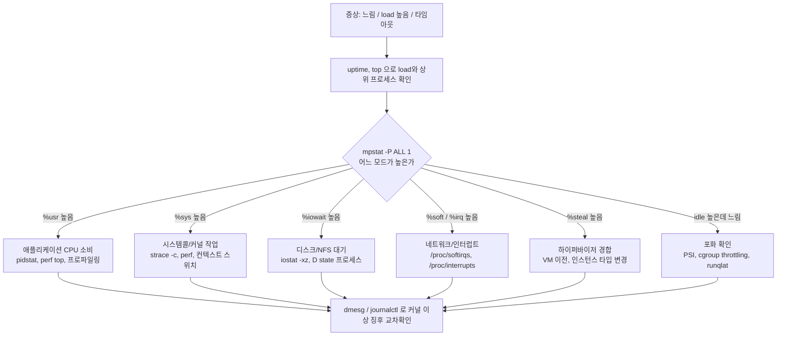

## 💬 TL;DR

> CPU 문제는 **사용률 → 포화(대기) → 에러** 순서로 본다.
> `uptime`의 load average는 CPU 외 I/O 대기(D state)도 포함하므로 단독 판단 금지.
> `mpstat`으로 높은 모드(us/sy/wa/si/st)를 분류한 뒤 원인(앱 / 시스템콜 / 디스크 / 인터럽트 / 하이퍼바이저 / cgroup 제한)을 좁히고, `dmesg`/`journalctl`로 커널 이상 징후를 교차 확인한다.

---

## 🔍 개요

| 항목      | 내용                                                                                                               |
| --------- | ------------------------------------------------------------------------------------------------------------------ |
| 난이도    | 초급 ~ 중급                                                                                                        |
| 대상      | Linux 서버 운영/SRE/인프라 담당자                                                                                  |
| 플랫폼    | RHEL/Rocky/Ubuntu 계열 물리 서버, VM, 컨테이너(cgroup)                                                             |
| 사전 지식 | 프로세스/스레드, 기본 shell                                                                                        |
| 근거      | 공개 자료(Brendan Gregg, 커널 PSI 문서, Indeed Engineering 등) + 일반 운영 지식. 출처 없는 항목은 "확인 필요" 표기 |

---

## 📋 1. Context — CPU를 어떻게 봐야 하는가

CPU 성능 분석은 USE 방법(Utilization / Saturation / Errors)으로 정리하면 빠짐이 없습니다.

| 관점        | 의미                       | 대표 지표                                            | 대표 도구                                           |
| ----------- | -------------------------- | ---------------------------------------------------- | --------------------------------------------------- |
| Utilization | CPU가 일하는 비율          | %us, %sy, %idle                                      | `mpstat`, `top`, `sar -u`                           |
| Saturation  | 일을 못 받고 기다리는 정도 | run queue(`r`), load average, run queue latency, PSI | `vmstat`, `uptime`, `runqlat`, `/proc/pressure/cpu` |
| Errors      | 하드웨어/커널 오류         | MCE, thermal throttle, soft lockup                   | `dmesg`, `journalctl -k`, `mcelog`                  |

> 사용률이 낮아도 포화가 높을 수 있다. (예: cgroup CPU 제한으로 throttling 되는 컨테이너) 사용률만 보지 않는 이유다.

### 전체 진단 흐름



---

## 📊 2. 핵심 CPU 지표

### 2.1 Load Average

`uptime` 또는 `/proc/loadavg`로 확인.

```bash
$ uptime
 14:02:11 up 41 days,  3:12,  2 users,  load average: 8.21, 6.10, 3.45
```

- 1/5/15분 값 3개 제공
- 실행 중/실행 대기(runnable) 스레드 + uninterruptible sleep(D state) 스레드 수를 센다 (Linux 고유 동작)
- 단순 평균이 아니라 지수 감쇠 이동 합. 단일 CPU-bound 스레드를 60초 돌려도 1분 값이 1.0이 아니라 약 0.62 (Gregg 실험)
- 1분 > 5분 > 15분 이면 부하 증가 추세, 반대면 감소 추세

> 코어 수로 나눠서 "1.0 초과 = 과부하"로 단정하는 방식은 Linux에서는 모호합니다. D state(디스크/NFS/락 대기)가 섞여 있기 때문입니다. 서비스 평소 기준선(baseline)과 비교하는 쪽이 정확합니다.

### 2.2 CPU 사용 모드 (top / mpstat / sar)

| 필드         | 의미                              | 높을 때 1차 의심                        |
| ------------ | --------------------------------- | --------------------------------------- |
| %usr (us)    | 사용자 영역 코드                  | 애플리케이션 연산, 루프, GC             |
| %nice (ni)   | nice 값이 조정된 사용자 프로세스  | 배치 작업                               |
| %sys (sy)    | 커널 영역(시스템콜 등)            | 과다 시스템콜, 락 경합, 컨텍스트 스위치 |
| %iowait (wa) | CPU가 idle이면서 I/O 완료 대기    | 디스크/스토리지/NFS 지연                |
| %irq (hi)    | 하드웨어 인터럽트 처리            | NIC/스토리지 인터럽트 쏠림              |
| %soft (si)   | 소프트웨어 인터럽트               | 네트워크 패킷 처리(NET_RX), 타이머      |
| %steal (st)  | 하이퍼바이저가 CPU를 다른 VM에 줌 | 호스트 오버커밋, noisy neighbor         |
| %guest       | 게스트 VM 실행 시간               | KVM 호스트에서 VM 구동                  |
| %idle        | 유휴                              | 낮으면 포화 가능성                      |

```bash
$ mpstat -P ALL 1
Linux 5.14.0 (srv01)    10/21/2026      _x86_64_        (8 CPU)

02:03:01 PM  CPU    %usr   %nice    %sys %iowait    %irq   %soft  %steal  %guest  %gnice   %idle
02:03:02 PM  all   62.10    0.00    8.40    0.50    0.00    1.20    0.00    0.00    0.00   27.80
02:03:02 PM    0   98.00    0.00    2.00    0.00    0.00    0.00    0.00    0.00    0.00    0.00
```

> 위 출력은 형식 예시입니다. 수치는 가상값입니다.

- `all` 평균만 보지 말고 CPU별로 본다. 특정 코어 하나만 100%면 단일 스레드 병목 또는 인터럽트 쏠림
- 원천 데이터는 `/proc/stat` (user nice system idle iowait irq softirq steal guest guest_nice 순, 단위 clock tick)

### 2.3 Run Queue 와 포화

```bash
$ vmstat 1
procs -----------memory---------- ---swap-- -----io---- -system-- ------cpu-----
 r  b   swpd   free   buff  cache   si   so    bi    bo   in   cs us sy id wa st
```

| 컬럼    | 의미                              | 판단                                    |
| ------- | --------------------------------- | --------------------------------------- |
| r       | 실행 대기 중인 프로세스 수        | 지속적으로 CPU 코어 수 초과 시 포화     |
| b       | uninterruptible sleep 프로세스 수 | 0 초과가 지속되면 I/O/락 대기 의심      |
| in / cs | 인터럽트/초, 컨텍스트 스위치/초   | 비정상적 급증 시 스레드 과다, 락 경합   |
| st      | steal                             | VM 환경에서 0 초과 지속이면 호스트 경합 |

Gregg는 CPU 포화를 가장 잘 보여주는 지표로 **run queue latency**(스케줄 대기 시간)를 꼽습니다.

```bash
# 프로세스별 스케줄 지연 누적
cat /proc/<PID>/schedstat

# 스케줄링 지연 요약
perf sched record -- sleep 10
perf sched latency

# bcc 도구 (설치 필요): 런큐 지연 히스토그램
runqlat 10 1
```

### 2.4 PSI (Pressure Stall Information)

커널이 "CPU를 기다리며 못 한 일"을 직접 시간 비율로 알려줍니다. (커널 4.20+, `CONFIG_PSI`. 일부 배포판은 부팅 파라미터 `psi=1` 필요 — 확인 필요)

```
$ cat /proc/pressure/cpu
some avg10=0.00 avg60=0.00 avg300=0.00 total=0
```

- `some`: 일부 태스크가 CPU를 기다린 시간 비율(%)
- avg10 / avg60 / avg300: 10/60/300초 평균
- total: 누적 stall 시간(마이크로초). 평균에 가려진 짧은 스파이크 확인용
- cgroup v2 에서는 각 cgroup 디렉터리의 `cpu.pressure` 로 컨테이너 단위 확인
- 최신 커널은 `cpu` 에도 `full` 라인이 보이지만 시스템 전체 값은 의미가 없는 것으로 알려짐 (확인 필요)

### 2.5 컨텍스트 스위치, 인터럽트, 소프트IRQ

```bash
# 프로세스별 컨텍스트 스위치 (cswch/s: 자발적, nvcswch/s: 비자발적)
pidstat -w 1

# 인터럽트 CPU 분포
cat /proc/interrupts

# 소프트IRQ 분포 (NET_RX 쏠림 확인)
watch -n1 'cat /proc/softirqs'
```

- 비자발적 컨텍스트 스위치(nvcswch)가 높으면 CPU 경쟁 중인 프로세스
- 특정 CPU 열에만 NET_RX 카운트가 몰리면 RSS/RPS/irqbalance 설정 점검

### 2.6 주파수 / 전력 / 열

```bash
lscpu
cpupower frequency-info
cat /sys/devices/system/cpu/cpu0/cpufreq/scaling_governor
turbostat --interval 5
```

- governor 가 `powersave` 이면 지연 민감 서비스에서 성능 저하 가능
- 열 제한(thermal throttling)이 걸리면 사용률은 그대로인데 처리량이 떨어짐

---

## 💻 3. 1분 진단 체크리스트 (60초 분석)

Brendan Gregg 의 "Linux Performance Analysis in 60,000 Milliseconds" 10개 명령 기반.

```bash
uptime                 # load 추세
dmesg -T | tail        # 최근 커널 메시지 (OOM, TCP drop 등)
vmstat 1               # r, b, si/so, us/sy/id/wa/st
mpstat -P ALL 1        # CPU별 모드 분포
pidstat 1              # 프로세스별 CPU
iostat -xz 1           # 디스크 사용률/지연
free -m                # 메모리, 캐시
sar -n DEV 1           # NIC 처리량
sar -n TCP,ETCP 1      # TCP 재전송 등
top                    # 종합 확인
```

> 각 명령의 세부 판독 기준은 위 표(2.2, 2.3)와 아래 4장 참고. 원문은 출처 섹션 링크 확인.

---

## 💻 4. OS에서 확인할 수 있는 로그와 상태

### 4.1 로그 위치

| 용도             | Debian/Ubuntu           | RHEL/Rocky          | 비고                                            |
| ---------------- | ----------------------- | ------------------- | ----------------------------------------------- |
| 일반 시스템 로그 | `/var/log/syslog`       | `/var/log/messages` | rsyslog 사용 시                                 |
| 커널 로그        | `/var/log/kern.log`     | `/var/log/messages` |                                                 |
| systemd 저널     | `journalctl`            | `journalctl`        | 영속 저장 여부는 `/var/log/journal` 존재로 확인 |
| 커널 링버퍼      | `dmesg`                 | `dmesg`             | 재부팅 시 초기화                                |
| sar 과거 통계    | `/var/log/sysstat/saDD` | `/var/log/sa/saDD`  | sysstat 설치/활성화 필요                        |
| 인증             | `/var/log/auth.log`     | `/var/log/secure`   | CPU 급증 시 무차별 대입 확인                    |

### 4.2 자주 쓰는 조회 명령

```bash
# 이번 부팅의 커널 메시지 (사람이 읽는 시간 표기)
dmesg -T | tail -100
journalctl -k -b

# 에러 이상만
journalctl -p err -b

# 특정 시간 구간
journalctl --since "2026-10-21 13:00" --until "2026-10-21 14:00"

# 특정 서비스
journalctl -u <service> --since "1 hour ago"

# 이전 부팅 (영속 저널 필요)
journalctl -b -1 -k
```

### 4.3 CPU 관련 커널 메시지 패턴

| 메시지 (일부)                                                                   | 의미                                                    | 우선 조치                                          |
| ------------------------------------------------------------------------------- | ------------------------------------------------------- | -------------------------------------------------- |
| `watchdog: BUG: soft lockup - CPU#N stuck for XXs!`                             | CPU가 오래 스케줄링 없이 커널 코드에 머묾               | 스택트레이스 확보, 드라이버/커널 버그, 과부하 점검 |
| `INFO: task <name>:<pid> blocked for more than 120 seconds.`                    | D state 로 장시간 정체(hung task)                       | 스토리지/NFS/락 점검                               |
| `rcu_sched self-detected stall on CPU` / `rcu: INFO: rcu_sched detected stalls` | RCU 정체, CPU 장시간 선점 불가                          | soft lockup 과 동일 계열로 분석                    |
| `CPUn: Core temperature above threshold, cpu clock throttled`                   | 열 제한으로 클럭 하향                                   | 냉각, 팬, 전원 정책 점검                           |
| `mce: [Hardware Error]` / `Machine check events logged`                         | CPU/메모리 하드웨어 오류                                | 하드웨어 벤더 진단, 교체 검토                      |
| `Out of memory: Killed process <pid>`                                           | OOM killer 동작 (CPU 문제처럼 보이는 swap/reclaim 유발) | 메모리 분석으로 전환                               |
| `nf_conntrack: table full, dropping packet`                                     | 네트워크 상태 테이블 포화 (si 상승과 동반 가능)         | conntrack 한도 점검                                |

> 메시지 문구는 커널 버전/배포판에 따라 다를 수 있습니다. 위 문구는 대표 형태이며 사용 중인 커널에서 `dmesg | grep -i -E "lockup|stall|blocked|throttl|mce"` 로 실제 표기를 확인하세요.

```bash
# 한 번에 훑기
dmesg -T | grep -i -E "lockup|stall|blocked for|throttl|mce|hardware error|oom"
```

### 4.4 과거 시점 확인 (sar)

장애가 지난 뒤에는 `sar` 로그만 남습니다. 사전에 sysstat 활성화가 필요합니다.

```bash
# 오늘 CPU 사용률 전체
sar -u

# CPU별
sar -P ALL

# 런큐/로드
sar -q

# 컨텍스트 스위치/프로세스 생성
sar -w

# 특정 시간대, 특정 날짜 파일
sar -u -s 13:00:00 -e 14:00:00 -f /var/log/sa/sa21
```

⚠️ 문제: 장애 후 원인 분석 시 CPU 이력이 없음
📝 원인: sysstat 미설치 또는 수집 비활성, 기본 수집 주기 10분이라 짧은 스파이크 누락
✅ 해결책: sysstat 활성화 후 수집 주기 단축(예: 1분) 또는 node_exporter/APM 등 외부 수집 병행

---

## 🔧 5. 증상별 원인 분석 및 해결

### 5.1 %usr 높음 — 애플리케이션이 CPU를 소비

```bash
# 상위 프로세스/스레드
top -H -p <PID>
pidstat -u -t -p <PID> 1

# 핫스팟 함수 (실시간)
perf top -p <PID>

# 샘플링 후 분석
perf record -F 99 -g -p <PID> -- sleep 30
perf report
```

- 해결 방향: 핫 함수 최적화, 불필요한 폴링/루프 제거, GC 튜닝(JVM 등), 스케일 아웃, 프로세스 수/스레드 풀 크기 조정
- 임시 완화: `renice`, `taskset`, cgroup CPU 제한으로 영향 범위 격리

### 5.2 %sys 높음 — 시스템콜/커널 작업

```bash
# 시스템콜 요약 (운영 서비스 대상 사용 시 오버헤드 큼, 짧게)
strace -c -f -p <PID>

# 커널 함수 포함 프로파일
perf top
perf record -g -a -- sleep 10
```

- 의심: 작은 I/O 반복, 잦은 `futex` 락 경합, 과도한 스레드 생성, 컨텍스트 스위치 폭증
- 해결 방향: 배치 처리, 락 범위 축소, 스레드 풀 제한

### 5.3 %iowait 높음 / load 높은데 CPU idle — D state

```bash
# D state 프로세스와 대기 중인 커널 함수
ps -eo state,pid,wchan:32,cmd | awk '$1=="D"'

# 디스크 지연/포화
iostat -xz 1
```

- 높은 `await`, `%util`, `aqu-sz` 와 함께 `wa` 상승이면 스토리지 병목
- NFS 사용 시 서버 응답 지연도 D state 로 보임
- `iowait` 는 "CPU가 바빠서"가 아니라 "CPU가 놀면서 I/O를 기다리는" 값입니다. CPU 증설로는 해결되지 않고 스토리지 쪽을 봐야 합니다.

### 5.4 %soft / %irq 높음 — 네트워크/인터럽트

```bash
cat /proc/softirqs
cat /proc/interrupts
sar -n DEV 1
ethtool -S <iface> | head -50
```

- 특정 CPU에 NET_RX 쏠림 시: `irqbalance` 동작 확인, NIC 큐 수(`ethtool -l`), RSS/RPS 설정 점검
- `ksoftirqd/N` 프로세스가 상위에 보이면 소프트IRQ 처리가 한계 도달 신호
- 패킷 폭주(DDoS 포함) 가능성은 `sar -n DEV`, 방화벽 로그로 교차 확인

### 5.5 %steal 높음 — VM 환경

- 호스트가 vCPU에 물리 CPU 시간을 못 주는 상태
- 게스트 안에서는 해결 불가, 호스트/클라우드 레벨 조치 필요
- 해결 방향: 다른 호스트로 이전, 전용 호스트, 인스턴스 타입 변경, 버스트형 인스턴스의 크레딧 소진 여부 확인(클라우드 제공자별 상이 — 확인 필요)

### 5.6 컨테이너 CPU Throttling — 사용률은 낮은데 느림

Indeed Engineering 사례에서 확인된 패턴입니다. CPU limit 은 CFS bandwidth control(quota/period)로 구현되며, 기간 안에 quota 를 다 쓰면 나머지 기간은 멈춥니다.

```bash
# cgroup v2
cat /sys/fs/cgroup/<path>/cpu.stat
# usage_usec, user_usec, system_usec, nr_periods, nr_throttled, throttled_usec ...

# cgroup v1
cat /sys/fs/cgroup/cpu/<path>/cpu.stat
# nr_periods, nr_throttled, throttled_time

# 컨테이너 단위 압력
cat /sys/fs/cgroup/<path>/cpu.pressure
```

- throttle 비율 = `nr_throttled / nr_periods`
- 예: limit 0.4 CPU, period 100ms 이면 100ms당 40ms만 실행 가능. 멀티스레드가 초반에 quota 를 소진하면 호스트가 한가해도 남은 60ms 동안 정지
- Kubernetes 환경에서는 cAdvisor 의 `container_cpu_cfs_throttled_periods_total` 계열 지표로 같은 값을 수집 (지표명은 버전별 확인 필요)

⚠️ 문제: 평균 CPU 사용률은 낮은데 응답 지연이 간헐적으로 튐
📝 원인: 짧은 버스트로 quota 소진 → period 나머지 구간 throttle
✅ 해결책: CPU limit 상향 또는 제거(request 만 설정), 스레드 수 축소, 워커 수를 limit 에 맞춤. 일부 커널(4.18 계열)은 과도한 throttling 회귀가 보고되어 커널 버전 점검 필요

### 5.7 특정 코어만 100%

```bash
mpstat -P ALL 1
ps -eLo pid,tid,psr,pcpu,comm --sort=-pcpu | head
cat /proc/interrupts
```

- 단일 스레드 프로세스 병목 → 구조 변경(멀티프로세스/스레드) 또는 CPU 클럭 우선 장비
- 인터럽트 쏠림 → `/proc/irq/<N>/smp_affinity` 조정, irqbalance
- `taskset -cp <PID>` 로 고정(pinning)된 프로세스 확인

### 5.8 CPU 주파수 / 전원 정책

```bash
cpupower frequency-info
cpupower frequency-set -g performance
```

- 지연 민감 서비스는 `performance` governor 가 유리하지만 전력·발열이 늘어납니다. 처리량 중심 배치 서버는 기본 정책으로도 충분한 경우가 많습니다.
- 설정은 재부팅 시 초기화되므로 영구 적용은 배포판별 방법(tuned, cpupower.service 등)으로 별도 설정 필요

---

## ⚠️ 6. 운영 시 주의사항

- `strace`, `perf record -g` 등은 대상 프로세스에 오버헤드를 줍니다. 운영 중에는 짧은 시간, 낮은 샘플링 주파수로 사용하세요.
- `iowait` 는 "CPU가 바쁘다"는 뜻이 아닙니다. 해석 오류가 가장 흔합니다.
- load average 단독 판단 금지. `r`, `b`, PSI, run queue latency 와 같이 본다.
- 평균(`all`)만 보면 단일 코어 포화를 놓칩니다.
- `dmesg` 는 링버퍼라 오래된 로그가 밀려납니다. 장애 직후 바로 `journalctl -k` 또는 파일로 저장하세요.

장애 대응 전 확인사항:

- [ ] `uptime` / `mpstat -P ALL` 결과를 먼저 파일로 저장 (재현 어려움)
- [ ] `dmesg -T`, `journalctl -k -b` 저장
- [ ] VM이면 `%steal` 확인
- [ ] 컨테이너면 `cpu.stat` 의 throttle 비율 확인
- [ ] 과거 시점 분석을 위해 sysstat 수집 활성 여부 확인
- [ ] 변경(배포, 설정, 커널 업데이트) 이력 확인

---

## 📊 7. 도구 요약

| 도구                         | 용도                                 | 패키지(RHEL / Debian)      |
| ---------------------------- | ------------------------------------ | -------------------------- |
| top / htop                   | 실시간 종합                          | procps-ng / procps         |
| vmstat                       | run queue, 메모리, CPU 요약          | procps-ng / procps         |
| mpstat, pidstat, iostat, sar | CPU별, 프로세스별, 디스크, 과거 통계 | sysstat                    |
| perf                         | 프로파일링, sched 분석               | perf / linux-tools         |
| bcc-tools (runqlat 등)       | eBPF 기반 지연 분석                  | bcc-tools / bpfcc-tools    |
| turbostat, cpupower          | 주파수, C-state, 전력                | kernel-tools / linux-tools |
| ethtool                      | NIC 통계/큐                          | ethtool                    |

---

## 🚀 다음 학습 로드맵

| 레벨 | 주제                                                                          |
| ---- | ----------------------------------------------------------------------------- |
| 기초 | `/proc/stat`, `/proc/loadavg`, top/vmstat 필드 읽기                           |
| 중급 | sysstat 운영, PSI 기반 알림, cgroup v2 CPU 제어                               |
| 고급 | perf + Flame Graph, eBPF(bcc/bpftrace) runqlat/offcputime, NUMA/스케줄러 튜닝 |

---

## 출처

- [Linux Load Averages: Solving the Mystery (Brendan Gregg)](https://www.brendangregg.com/blog/2017-08-08/linux-load-averages.html) — load average 정의, 대체 지표
- [Linux performance analysis in 60 seconds (Thomas-Krenn Wiki)](https://www.thomas-krenn.com/en/wiki/Linux_performance_analysis_in_60_seconds) — 10개 명령 목록 (각 명령 판독 기준은 페이지에 없음, 본 문서 해석은 일반 운영 지식)
- [Linux Kernel PSI 문서 (psi.rst, 미러)](https://stuff.mit.edu/afs/sipb.mit.edu/contrib/linux/Documentation/accounting/psi.rst) — PSI 파일, 포맷, trigger (구버전 미러이므로 최신 커널 차이는 확인 필요)
- [Unthrottled: Fixing CPU Limits in the Cloud (Indeed Engineering)](https://engineering.indeedblog.com/blog/2019/12/unthrottled-fixing-cpu-limits-in-the-cloud/) — CFS throttling 메커니즘, cpu.stat 필드

### 확인 필요 항목 요약

- PSI 활성 조건(`psi=1`)과 `/proc/pressure/cpu` 의 `full` 라인 지원 커널 버전
- 4장 커널 메시지 문구의 배포판/커널별 차이
- Kubernetes cAdvisor 지표명 버전별 차이
- 클라우드 버스트 인스턴스 크레딧 지표 (제공자별)
- 위 명령 출력 예시는 형식 설명용 가상값이며 실제 서버에서 재확인 필요
