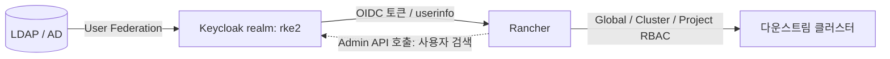
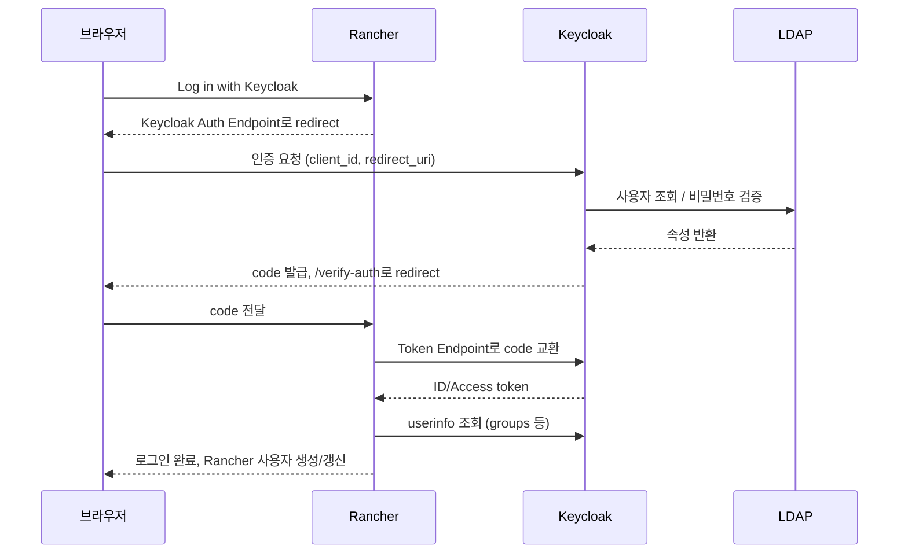

| 항목 | 내용 |
|------|------|
| 난이도 | 중급 ~ 고급 |
| 대상 | Rancher / Keycloak 운영 담당자 |
| 구성 | Rancher(RKE2 위 Helm 설치) + Keycloak(realm `rke2`) + LDAP(AD/OpenLDAP) |
| 인증 방식 | Keycloak (OIDC), Authorization Code Flow |
| 사전 지식 | OIDC 기본 흐름, Kubernetes RBAC, Helm |
| 근거 | 실제 구성 과정에서 발생한 이슈 + Rancher 공식 문서 |

**TL;DR**: Rancher는 로그인을 Keycloak에 위임하고, Keycloak은 사용자 정보를 LDAP에서 가져온다.
인증(누구인가)은 Keycloak, 권한(무엇을 할 수 있는가)은 Rancher RBAC이 맡는다.
member 검색, 로그아웃, 표시 이름 같은 부가 기능에서 문제가 생기며, 원인은 대부분 Keycloak client 설정(audience, role mapping, redirect URI)에 있다.

---

## 📋 1. 구성요소와 역할

### Context

Rancher는 자체 로컬 계정(`admin`)을 갖고 있지만, 팀 단위로 운영하려면 외부 IdP 연동이 필요하다.
이 구성에서는 Keycloak이 IdP 역할을 하고, 사용자 원본은 LDAP에 둔다.

| 구성요소 | 역할 | 저장하는 것 |
|----------|------|-------------|
| LDAP (AD/OpenLDAP) | 사용자 원본 | `sAMAccountName`/`uid`, `cn`, `sn`, `givenName`, `displayName` |
| Keycloak | 인증 제공자(IdP) | realm, client, 사용자 캐시, 세션, 토큰 발급 |
| Rancher | 인증 소비자(RP)이자 권한 관리 | Rancher 사용자(`u-xxxxx`), role binding |
| 다운스트림 K8s | 실제 리소스 | 클러스터 RBAC (Rancher가 동기화) |

### 인증과 권한은 서로 다른 계층

> Keycloak의 권한과 Rancher의 권한은 서로 다른 시스템의 권한이며, 한쪽을 고쳐도 다른 쪽에는 영향이 없습니다.



| 계층 | 권한 종류 | 설정 위치 |
|------|-----------|-----------|
| Keycloak | `realm-management`의 `view-users` 등 | Users/Groups → Role mapping |
| Rancher | Global, Cluster, Project 역할 | Users & Authentication, Cluster Members, Project Members |
| Kubernetes | ClusterRole, RoleBinding | Rancher가 자동 생성, import 시 `cluster-admin` 필요 |

---

## 🚀 2. 로그인 흐름

로그인 버튼 클릭부터 Rancher 사용자 생성까지의 흐름이다.



- Auth Endpoint, Token Endpoint, Userinfo Endpoint는 Issuer URL 기준으로 자동 생성 가능
- Redirect 경로는 `https://<rancher>/verify-auth`
- 최초 로그인한 Keycloak 사용자가 Rancher의 admin으로 지정됨

---

## 💻 3. Keycloak 설정

### 3-1. Client 기본값

공식 문서 기준 값이다. Client authentication은 ON이어야 Credentials 탭과 Client Secret이 생성된다.

| 항목 | 값 |
|------|----|
| Client type | OpenID Connect |
| Client ID | `rancher` |
| Client authentication | ON |
| Valid redirect URIs | `https://<rancher>/verify-auth` |
| Valid post logout redirect URIs | `https://<rancher>/*` (로그아웃 사용 시) |

### 3-2. Mapper (`rancher-dedicated` 스코프)

`rancher-dedicated`는 client 생성 시 자동으로 만들어지는 전용 스코프이며, 직접 만들지 않는다.
client를 새로 만들면 이 스코프 안의 mapper는 비어 있으므로 다시 추가해야 한다.

| Mapper | 타입 | 주요 설정 |
|--------|------|-----------|
| Client Audience | Audience | Included Client Audience `rancher`, Add to access token ON, Add to ID token OFF |
| Groups Mapper | Group Membership | Claim `groups`, Full group path OFF, ID token OFF, access token OFF, **userinfo ON** |
| Group Path (선택) | Group Membership | Claim `full_group_path`, Full group path ON |

내장 client(`account`, `account-console`, `security-admin-console`)는 Rancher 연동과 무관하므로 수정하지 않는다.

### 3-3. Rancher 쪽 입력값

```bash
# 저장된 설정 확인 (Secret 값 제외)
kubectl get authconfigs.management.cattle.io keycloakoidc -o yaml | grep -v -i secret
```

| 항목 | 값 |
|------|----|
| Client ID / Secret | Keycloak의 `rancher` client 값 |
| Issuer | `https://<keycloak>/realms/<realm>` (Keycloak 16 이하는 `/auth` 포함) |
| Rancher URL | `https://<rancher>/verify-auth` |

> Issuer는 `.well-known/openid-configuration`의 `issuer` 값을 그대로 복사하는 방식이 가장 안전합니다.

---

## 🔧 4. LDAP 연동과 사용자 이름 표시

### Problem

Rancher에 "이재우(jlee46) 이"처럼 이름이 이어 붙어 표시됨.

### 원인

Keycloak의 `name` claim은 First name + Last name을 합친 값이다.
LDAP의 `cn`이 `이재우(jlee46)` 형태이고, first name mapper가 `cn`을, last name mapper가 `sn`(`이`)을 읽으면 두 값이 이어 붙는다.

| 속성 | 값 예시 | 비고 |
|------|---------|------|
| `cn` | `김정식(jeongsikim)` | 조직 규칙에 따라 로그인 ID가 괄호로 포함 |
| `sn` | `김` | 성 |
| `givenName` | `정식` | 한국어는 비어 있는 경우도 있음 |
| `displayName` | `김정식` | 선택 속성 |
| `sAMAccountName` | `jeongsikim` | AD 로그인 ID (OpenLDAP은 `uid`) |

### Solution

| 조회 결과 | Mapper 설정 |
|-----------|-------------|
| `displayName`이 깔끔함 | first name → `displayName`, last name mapper 삭제 |
| `givenName`, `sn`이 정상 | first name → `givenName`, last name → `sn` (Keycloak은 "이름 성" 순서로 합침) |
| `cn`에만 이름이 있음 | Mapper로는 괄호 제거 불가, LDAP 데이터 수정 또는 Rancher 쪽 `displayName` 직접 수정 |

```bash
# AD 기준 속성 조회 (한글은 base64로 출력되므로 디코딩)
ldapsearch -x -LLL -H ldap://<ad-host>:389 \
  -D "<bind-account>@<domain>" -W \
  -b "<base-dn>" -o ldif-wrap=no \
  "(sAMAccountName=<id>)" \
  dn cn sn givenName displayName sAMAccountName \
| perl -MMIME::Base64 -ne 'if (/^(\w+):: (.*)$/) { print "$1: ", decode_base64($2), "\n" } else { print }'
```

```bash
# 이미 생성된 Rancher 사용자의 표시 이름 수정
kubectl patch users.management.cattle.io <u-xxxxx> --type merge -p '{"displayName":"김정식"}'
```

⚠️ 문제: last name mapper를 비우면 sync 시 사용자가 `failed`로 빠질 수 있음
📝 원인: 최신 Keycloak의 User profile에서 `lastName`이 필수 속성인 경우
✅ 해결책: Realm settings → User profile → `lastName`의 Required 해제

Rancher가 재로그인 시 `displayName`을 다시 갱신하는지는 버전에 따라 다르다 (확인 필요). 한 명으로 먼저 테스트한 뒤 나머지를 일괄 처리하는 방식을 권장한다.

---

## 📋 5. Rancher 사용자와 권한 모델

### 사용자 식별

| 항목 | 내용 |
|------|------|
| Rancher 사용자 | `users.management.cattle.io`, 이름은 `u-xxxxx` |
| Keycloak principal | `keycloakoidc_user://<Keycloak 사용자 UUID>` |
| 그룹 principal | `keycloakoidc_group://<그룹명>` |
| 로컬 principal | `local://u-xxxxx` |

Rancher는 `sub` claim을 고유 ID로 사용한다. Keycloak 사용자를 삭제하고 다시 만들어 UUID가 바뀌면 Rancher에서는 별개의 사용자로 인식되고, 기존 권한은 이어지지 않는다.

### 권한 리소스

| 범위 | 리소스 | 설정 위치 |
|------|--------|-----------|
| Global | `GlobalRoleBinding` | Users → Edit Config → Global Permissions |
| Cluster | `ClusterRoleTemplateBinding` | Cluster Members |
| Project | `ProjectRoleTemplateBinding` | Project → Members |

PRTB 하나는 사용자(또는 그룹) 하나에 역할 하나를 연결한다. 기존 바인딩에 사용자를 추가하는 방식이 아니라 바인딩을 새로 만든다.

```yaml
# 프로젝트에 사용자 추가 (kubectl create -f 로 실행)
apiVersion: management.cattle.io/v3
kind: ProjectRoleTemplateBinding
metadata:
  generateName: prtb-
  namespace: <project-id>
projectName: <cluster-id>:<project-id>
roleTemplateName: project-member
userName: u-xxxxx        # 또는 userPrincipalName / groupPrincipalName 중 하나
```

여러 명에게 같은 권한을 줄 때는 사용자별 바인딩보다 Keycloak 그룹에 바인딩 하나를 거는 방식이 관리 면에서 유리합니다.
다만 그룹 claim이 토큰/userinfo에 정상적으로 들어와야 하고, Full group path 설정에 따라 그룹명이 `/그룹명`으로 들어올 수 있으므로 불리한 경우도 있습니다.

### 로컬 admin 복구 경로

```
https://<rancher>/login?local
```

```bash
# 비밀번호 재설정
kubectl -n cattle-system exec <rancher-pod> -- reset-password
```

Keycloak 연동에 문제가 생겼을 때의 복구 경로이므로, 로컬 admin은 삭제하지 않고 비상용으로 유지한다.

---

## ⚠️ 6. Rancher → Keycloak 호출 시 발생한 권한 이슈

Rancher는 로그인 이후에도 사용자 검색(project member 추가 등)을 위해 Keycloak Admin API를 호출한다.
호출 주체가 로그인 사용자의 토큰인지, 별도 자격인지는 문서에서 확정하지 못했다 (확인 필요).

### 증상별 정리

| 로그 메시지 | 원인 | 해결 |
|-------------|------|------|
| `failed to verify id token oidc expected audience rancher got account` | 토큰의 `aud`에 `account`만 있고 `rancher`가 없음 | `rancher-dedicated`에 Audience mapper 추가 후 재로그인 |
| `/admin/realms/<realm>/users?search=... 403 access denied` | 호출 계정에 Keycloak 조회 권한 없음 | `realm-management` 역할 부여 |
| `searchPrincipals ... oauth2: invalid_grant token is not active` | Keycloak이 refresh token을 거부 | 완전 로그아웃 후 재로그인, 세션/토큰 설정 점검 |
| `unable to fetch principal info` (Cluster Members) | 바인딩의 principal이 현재 IdP에서 조회되지 않음 | 고아 바인딩 삭제, 새 사용자로 재지정 |

### 역할 부여 방법

⚠️ 문제: member 검색 시 403
📝 원인: Rancher에 로그인한 Keycloak 계정에 `realm-management` client role이 없음
✅ 해결책: Role mapping에서 **Client roles**(`realm-management`)를 선택하여 부여

| 단계 | 내용 |
|------|------|
| 1 | `https://<rancher>/v3/principals?me=true`로 내 `keycloakoidc_user://<UUID>` 확인 |
| 2 | Keycloak에서 해당 UUID의 사용자 열기 |
| 3 | Role mapping → Assign role → **Filter by clients** → `realm-management` |
| 4 | `view-users`, `query-users`, `query-groups` 선택 |
| 5 | `rancher-dedicated` → Scope → **Full scope allowed** ON 확인 |
| 6 | Clients → `rancher` → Client scopes → **Evaluate**로 토큰의 `resource_access` 확인 |
| 7 | Rancher 로그아웃 후 Keycloak 계정으로 재로그인 |

> Realm roles에는 `view-users`가 나오지 않습니다. 이 역할은 `realm-management` client에 속한 Client role입니다.

Rancher 문서/이슈 기준으로 `query-users`, `query-groups`, `view-users`를 사용자 또는 그룹에 부여하면 검색이 가능해진다. 권한이 넓으므로 Rancher 관리자 계정이나 전용 그룹에만 부여한다.

### Audience 이슈에 대한 메모

공식 문서는 Audience mapper를 필수 설정으로 안내한다.
다른 환경에서는 이 mapper 없이도 동작했으나, 원인은 확인하지 못했다 (확인 필요).
Keycloak은 기본적으로 사용자가 가진 client role의 client를 `aud`에 넣고 기본 사용자는 `account` client 역할을 가지므로 `aud`에 `account`가 들어가는 것으로 추정된다.
문서 기준 설정을 따르면 환경 간 차이와 무관하게 동작이 고정된다.

### 그룹 검색

최초 설정 사용자가 그룹에 속해 있지 않으면 `groupSearchEnabled`가 false가 되어 그룹 검색이 안 되는 이슈가 보고되어 있다.

```bash
kubectl get authconfigs.management.cattle.io keycloakoidc -o yaml | grep -i groupSearch
kubectl patch authconfigs.management.cattle.io keycloakoidc --type merge -p '{"groupSearchEnabled":true}'
```

Auth Provider 화면에서 다시 Save하면 patch한 값이 덮어써질 수 있으므로 patch는 마지막에 한다.

---

## 🔧 7. 로그아웃 (SSO 세션)

### Context

기본 동작에서 Rancher 로그아웃은 Rancher 세션만 종료하고 Keycloak SSO 세션은 유지한다.
이 경우 다시 로그인 버튼을 누르면 비밀번호 없이 바로 로그인된다.
로그아웃 후 아래 문구가 표시되는 것은 이 상태에 해당한다.

```
You've been logged out of Rancher, however you may still be logged in to your single sign-on identity provider
```

### Solution

OIDC RP-initiated logout은 IdP의 `end_session_endpoint`를 호출하는 방식이다.
Keycloak 쪽 일반 동작으로는 `id_token_hint`와 `post_logout_redirect_uri`가 핵심 파라미터다.

```bash
kubectl get authconfigs.management.cattle.io keycloakoidc -o yaml | grep -i -E "endSession|logoutAll"
```

| 필드 | 의미 (추정, 버전별 동작 확인 필요) |
|------|------------------------------------|
| `endSessionEndpoint` | Keycloak logout 주소 `https://<keycloak>/realms/<realm>/protocol/openid-connect/logout` |
| `logoutAllSupported` | provider 전체 로그아웃 지원 여부 |
| `logoutAllEnabled` | 로그아웃 시 provider 세션도 종료 |
| `logoutAllForced` | 사용자 선택 없이 항상 provider까지 종료 |

Auth Provider 화면의 **Logout Behavior** 설정이 이 필드들과 대응되는 것으로 보인다 (매핑 확인 필요).

### Invalid redirect uri

⚠️ 문제: 로그아웃 시 `Invalid redirect uri`
📝 원인: `post_logout_redirect_uri`가 client의 Valid post logout redirect URIs에 없음
✅ 해결책: 실제 요청의 값을 확인해 등록

이 환경에서 실제 요청에 포함된 값(URL 디코딩 결과)은 아래와 같았다.

```
https://<rancher>/dashboard/auth/verify?is-slo&logged-out
```

```
# Valid post logout redirect URIs
https://<rancher>/dashboard/auth/verify*
# 또는
https://<rancher>/*
```

쿼리스트링이 붙는 주소는 정확히 일치하는 항목으로 등록하면 매칭이 안 될 수 있으므로 `*`를 붙인 형태로 등록한다.
등록 후에도 안내 문구가 남는 경우가 있으며, 이는 문구와 별개로 **재로그인 시 Keycloak 로그인 화면이 다시 뜨는지**로 실제 종료 여부를 판단한다.

---

## 📊 8. 프록시(L7) 환경 고려사항

Rancher와 Keycloak 앞에 L7 장비와 ingress-nginx가 있으면 헤더 전달이 인증 동작에 영향을 준다.

| 구분 | 영향 |
|------|------|
| `X-Forwarded-Proto`, `Host` | redirect URI, issuer 주소 생성에 직접 영향 |
| `X-Forwarded-For` / `CLIENT-IP` | 로그의 클라이언트 IP, Keycloak 이벤트 IP에만 영향 |
| Keycloak 설정 | `KC_HOSTNAME`, `KC_PROXY_HEADERS`(구버전 `KC_PROXY`) |


원본 IP가 로그에 L7 장비 주소로 찍히는 경우, ingress-nginx의 신뢰 프록시 설정이 필요하다.

```yaml
# RKE2의 HelmChartConfig (kube-system)
apiVersion: helm.cattle.io/v1
kind: HelmChartConfig
metadata:
  name: rke2-ingress-nginx
  namespace: kube-system
spec:
  valuesContent: |-
    controller:
      config:
        use-forwarded-headers: "true"
        forwarded-for-header: "CLIENT-IP"
        proxy-real-ip-cidr: "<L7 장비 IP>/32"
```

`proxy-real-ip-cidr`는 ingress-nginx에 **직접 연결하는 상대 주소**여야 하며, 범위를 넓게 잡으면 그 안의 호스트가 헤더로 IP를 위조할 수 있습니다.
이 설정은 해당 ingress controller를 쓰는 모든 Ingress(Keycloak 포함)에 적용된다.
L7이 헤더를 실제로 보내는지는 `log-format-upstream`에 `$http_client_ip`를 찍어 확인한다 (확인 후 원복).

원본 IP 확인은 필수 설정이 아니며, 이 환경에서는 `cluster not found` 로그 원인 추적에 사용했다.

---

## ⚠️ 9. Rancher 재설치 시 영향

Rancher만 재설치하고 Keycloak을 유지한 경우다.

| 대상 | 영향 |
|------|------|
| Keycloak client/realm/사용자 UUID | 그대로 유지 |
| Rancher 사용자(`u-xxxxx`), role binding | 모두 새로 생성, 권한 재지정 필요 |
| Keycloak 세션/refresh token | 유지되나 새 Rancher는 이를 모름 |
| 옛 다운스트림 agent | 같은 hostname으로 계속 접속 시도, `400 cluster not found` |

⚠️ 문제: 재설치 후 `tunnel request ... response 400: cluster not found`
📝 원인: 옛 Rancher에 등록된 클러스터의 `cattle-cluster-agent`가 새 Rancher에 재접속하나 해당 Cluster 객체가 없음
✅ 해결책: 새 Rancher에서 클러스터를 다시 import하거나, 관리하지 않을 클러스터는 agent 제거

```bash
# 해당 클러스터에서 agent 환경 확인
kubectl -n cattle-system get deploy cattle-cluster-agent \
  -o jsonpath='{range .spec.template.spec.containers[0].env[*]}{.name}={.value}{"\n"}{end}' | grep CATTLE_
```

import 화면의 `cluster-admin-binding` 단계는 kubectl을 실행하는 사용자의 Kubernetes RBAC 문제이며, Keycloak 권한과 무관하다. 이미 `cluster-admin` 권한이 있으면 건너뛴다.

```bash
kubectl auth can-i '*' '*'
kubectl auth whoami   # 쿠버네티스 1.27 이상
```

⚠️ RKE2 내장 CRD(`addons.k3s.cattle.io`, `helmcharts.helm.cattle.io`, `helmchartconfigs.helm.cattle.io`)는 이름에 `cattle.io`가 들어 있어도 Rancher 리소스가 아니므로 삭제하지 않는다.

---

## 📋 10. 점검 체크리스트

Keycloak:
- [ ] `rancher` client의 Client authentication ON, Client Secret 확인
- [ ] Valid redirect URIs에 `https://<rancher>/verify-auth`
- [ ] Valid post logout redirect URIs 등록
- [ ] `rancher-dedicated`에 Audience, Groups mapper 존재
- [ ] Full scope allowed ON
- [ ] Evaluate로 `aud`에 `rancher`, `resource_access`에 `realm-management` 역할 확인
- [ ] Rancher 관리자 계정에 `view-users`, `query-users`, `query-groups` 부여
- [ ] LDAP first/last name mapper가 의도한 속성을 읽는지 확인
- [ ] `lastName` Required 설정 확인

Rancher:
- [ ] Issuer의 realm 이름이 실제 realm과 일치 (로그에서 `rke`/`rke2` 오타 주의)
- [ ] `server-url`이 경로 없는 외부 도메인
- [ ] `authconfig`의 `endSessionEndpoint`, `logoutAll*`, `groupSearchEnabled` 값 확인
- [ ] 로컬 admin 비상 경로(`login?local`) 유지
- [ ] 로그인 후 `/v3/principals?me=true`의 `id`가 `keycloakoidc_user://...`인지 확인

프록시:
- [ ] L7이 `X-Forwarded-Proto: https` 전달
- [ ] Keycloak `KC_HOSTNAME`, 프록시 헤더 설정 확인

---

## 🔍 11. 확인 필요 항목

이번 구성에서 문서나 테스트로 확정하지 못한 부분이다.

| 항목 | 상태 |
|------|------|
| Rancher가 Keycloak Admin API 호출 시 사용하는 토큰 주체 | 문서에서 확정 못 함. 로그인 사용자 토큰으로 추정 |
| Logout Behavior 설정과 `logoutAll*` 필드의 정확한 대응 | 버전별 확인 필요 |
| 재로그인 시 Rancher `displayName` 자동 갱신 여부 | 버전별 확인 필요 |
| 다른 환경이 Audience mapper 없이 동작하는 이유 | 미확인 (`roles` scope의 audience resolve 등 가설) |
| Rancher 버전별 `/dashboard/auth/verify` 로그아웃 redirect 경로 | 이 환경에서만 확인 |
| `cattle-tokens` namespace의 정확한 용도 | 문서 미확인. 새 토큰 API(`tokens.ext.cattle.io`, v2.12 이상)와 관련 추정 |

---

## 다음 학습 로드맵

| 레벨 | 주제 |
|------|------|
| 기초 | OIDC Authorization Code Flow, Keycloak realm/client 개념 |
| 중급 | Rancher RBAC(Global/Cluster/Project), 그룹 기반 권한 설계 |
| 고급 | Keycloak LDAP federation 튜닝, 토큰 수명/세션 정책, 프록시 헤더 설계 |

---

## 출처

- Rancher 공식 문서, Configure Keycloak (OIDC): https://ranchermanager.docs.rancher.com/how-to-guides/new-user-guides/authentication-permissions-and-global-configuration/authentication-config/configure-keycloak-oidc
- Rancher 공식 문서, Configure Generic OIDC: https://ranchermanager.docs.rancher.com/how-to-guides/new-user-guides/authentication-permissions-and-global-configuration/authentication-config/configure-generic-oidc
- rancher-docs Issue #1176, Improve OIDC / Rancher/Keycloak docs (`view-users`로 검색 가능): https://github.com/rancher/rancher-docs/issues/1176
- rancher Issue #48146, Keycloak OIDC group search workaround (`groupSearchEnabled`): https://github.com/rancher/rancher/issues/48146
- SUSE Rancher Manager, Tokens API (`tokens.ext.cattle.io`): https://documentation.suse.com/cloudnative/rancher-manager/v2.12/en/api/workflows/tokens.html
- Keycloak 포럼, OIDC RP-initiated logout 사례: https://forum.keycloak.org/t/solved-oidc-rp-initiated-logout/28941
- 이 문서의 로그, 설정값, 증상은 실제 구성 작업 중 확인한 내용이며 도메인과 계정 정보는 일반화함
